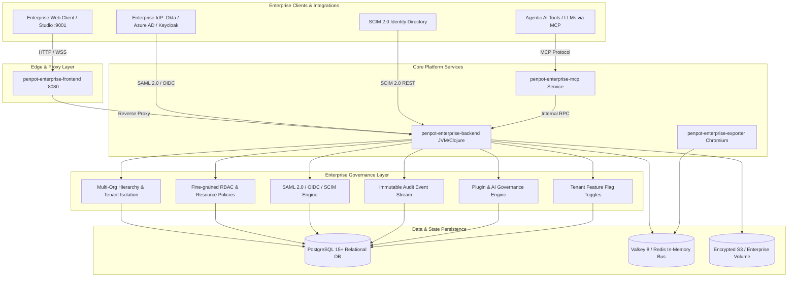

# Penpot Enterprise Platform Architecture Blueprint
**Step 1 Foundation & System Design Document**

---

## 1. Executive Summary & Philosophy

This platform is an enterprise-grade collaborative design ecosystem derived from canonical `penpot/penpot` (version 2.17.2). It is designed to meet the rigorous security, scalability, multi-tenancy, and governance requirements of Fortune 500 organizations, government institutions, and high-concurrency design teams.

### Non-Negotiable Tenets:
1. **Zero Degradation & 100% Core Preservation**: Every single existing Penpot feature—the WebAssembly rendering engine, SVG DOM pipeline, real-time multi-user CRDT sync bus, flexbox & grid layout managers, and component token libraries—remains 100% intact and untouched.
2. **First-Class Multi-Tenancy**: The baseline open-source Penpot concept of single "teams" is elevated into an overarching enterprise multi-organization hierarchy with departmental subdivisions and isolated billing boundaries.
3. **Enterprise Compliance & Trust**: Granular RBAC, audit event streams, SCIM automated directory sync, and AI model governance policies are embedded at the architecture level.

---

## 2. System Architecture Diagram

---

## 3. Subsystem Breakdown

### 3.1 Multi-Organization Hierarchy
Standard Penpot organizes profiles directly into teams. The Enterprise layer introduces:
- **`enterprise_organization`**: Root tenant container defining enterprise boundaries, seat capacities, domain allowlists, storage quotas, and compliance profiles.
- **`enterprise_organization_team`**: Structural binding mapping standard teams into departmental silos (e.g., Design Systems, Brand, Product Experience, Core Engineering) with cost-center tracking.
- **`enterprise_organization_member`**: Organization-level user directory establishing global enterprise roles.

### 3.2 Advanced RBAC & Governance
Replaces rigid binary admin/member flags with a hierarchical capability matrix:
| Role Code | Display Name | Scope & Capabilities |
|---|---|---|
| `super_admin` | Super Administrator | Root infrastructure governance, system-wide policies, cross-org auditing. |
| `org_admin` | Organization Administrator | Complete tenant control: SSO setup, billing, seat provisioning, AI governance, team allocation. |
| `team_lead` | Team Lead | Team membership management, design project creation, library publishing, tool approvals. |
| `member` | Enterprise Member | Design creation, canvas manipulation, commenting, execution of approved AI tools. |
| `restricted_editor` | Restricted Editor | Canvas modification restricted exclusively to explicitly assigned projects; no library publication. |
| `guest_viewer` | Guest Viewer | Read-only inspection, presentation view, comment placement; zero canvas mutation rights. |

### 3.3 Enterprise SSO & Identity (SAML 2.0, OIDC, SCIM)
- **SAML 2.0**: Native enterprise IdP federation with support for Okta, Azure Active Directory, PingFederate, and Keycloak, handling SP-initiated and IdP-initiated assertions, signed responses, and X.509 certificate rotations.
- **OpenID Connect (OIDC)**: PKCE-compliant OAuth2/OIDC integration with automated claim-to-role mappings.
- **SCIM 2.0 Provisioning**: Token-authenticated REST endpoints (`/scim/v2/Users`, `/scim/v2/Groups`) supporting real-time provisioning, profile synchronizations, and immediate deactivation upon employee departure.

### 3.4 Immutable Audit Logging System
Every administrative, authorization, and data extraction action is committed to `enterprise_audit_log` with:
- **Actor Metadata**: Profile ID, IP address, user-agent, session ID, or Agent ID.
- **Structured Categorization**: `authentication`, `authorization`, `organization`, `team`, `file_access`, `ai_execution`, `billing`, `compliance`.
- **SIEM Readiness**: Indexed for sub-second compliance querying and batch export to Datadog, Splunk, Elastic, or S3.

### 3.5 Plugin & Agentic AI Governance
Prevents intellectual property leakage and governs autonomous agent operations:
- **MCP Allowlist**: Only verified Model Context Protocol servers and approved tool definitions can be executed.
- **Canvas Write Boundary**: Explicit toggle (`allow_canvas_write`) determining whether AI agents can mutate production canvases or only read layers.
- **Zero-Data Retention & Privacy**: Enforces strict telemetry bans and prohibits models that train on enterprise customer data.

### 3.6 Tenant Feature Flag Engine
Allows phased release of new capabilities to specific customer cohorts:
- Global percentage rollouts (`0%` to `100%`).
- Granular overrides at Organization, Team, or Individual Profile levels.
- Pre-seeded flags for Multi-Org Tenancy, SAML 2.0, SCIM Provisioning, SIEM Streaming, Agentic AI Canvas Editing, and Custom RBAC.

---

## 4. Database Schema Catalog

All enterprise tables are instantiated via native Penpot migration `backend/src/app/migrations/sql/0153-enterprise-core-schema.sql`:

1. `enterprise_organization`
2. `enterprise_organization_team`
3. `enterprise_organization_member`
4. `enterprise_role_definition`
5. `enterprise_resource_policy`
6. `enterprise_sso_config`
7. `enterprise_scim_token`
8. `enterprise_scim_user_mapping`
9. `enterprise_audit_log`
10. `enterprise_ai_governance_policy`
11. `enterprise_feature_flag`
12. `enterprise_feature_flag_override`

---

## 5. Local Orchestration & Service Ports

| Service | Container Name | Host Port | Target Port | Protocol | Purpose |
|---|---|---|---|---|---|
| **Frontend** | `penpot-enterprise-frontend` | `9001` | `8080` | HTTP | Penpot Design Studio & Proxy |
| **Backend** | `penpot-enterprise-backend` | - | `6060` | HTTP / WSS | Clojure Core API & Sync Bus |
| **MCP** | `penpot-enterprise-mcp` | - | `3000` | HTTP / SSE | Model Context Protocol Agent Bridge |
| **Exporter** | `penpot-enterprise-exporter` | - | `80` | HTTP | Headless SVG / PDF / PNG Renderer |
| **PostgreSQL** | `penpot-enterprise-postgres` | `5432` | `5432` | TCP | Relational DB & Document Store |
| **Valkey** | `penpot-enterprise-valkey` | `6379` | `6379` | TCP | Pub/Sub Sync & Session Cache |
| **Mailcatcher** | `penpot-enterprise-mailcatch` | `1080` | `1080` | HTTP | Local Development SMTP Web Mail |
