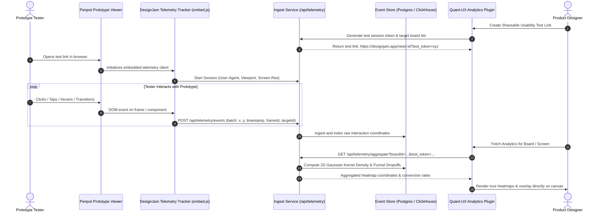

# Prototype Telemetry & Usability Event Ingest Architecture

## 1. Executive Summary & Problem Statement

Currently, the `quantux-analytics-plugin` inside Penpot displays heatmap overlays, journey funnels, and A/B test metrics based on simulated/preview points. To achieve true usability testing parity with tools like Quant-UX, the platform must capture real user interactions on live prototype views and ingest them into a persistent telemetry store.

Penpot plugins run inside a sandboxed iframe inside the workspace editor. A plugin *cannot* directly listen to interactions occurring on external shared prototype URLs without a dedicated telemetry client script embedded into the prototype viewer runtime and a companion ingest backend service.

---

## 2. System Architecture



---

## 3. Component Breakdown

### A. Client-Side Telemetry Tracker (`tracker.js`)
* **Size Target:** < 5 KB gzip (zero external dependencies).
* **Execution Environment:** Injected into Penpot's prototype view (`/view/:id`) or bundled via a lightweight standalone runner.
* **Captured Events:**
  1. `pointerdown` / `click`: Normalized relative `(x, y)` percentages relative to the active Penpot artboard / frame rather than absolute browser viewport coordinates (preventing distortion across device screen sizes).
  2. `dead_click`: Clicks on non-interactive elements (identifies user frustration).
  3. `frame_transition`: Timestamp when tester transitions between frames/boards.
  4. `session_metadata`: Viewport dimensions, device pixel ratio, referrer, user agent.
* **Transmission Protocol:** Batched every 2 seconds or flushed on `pagehide`/`visibilitychange` via `navigator.sendBeacon`.

```typescript
interface TelemetryInteractionEvent {
  sessionId: string;
  testToken: string;
  boardId: string;
  frameId: string;
  eventType: 'click' | 'tap' | 'dead_click' | 'view' | 'transition';
  relX: number; // 0.0 - 1.0 (relative to artboard width)
  relY: number; // 0.0 - 1.0 (relative to artboard height)
  absX: number; // Pixels
  absY: number; // Pixels
  timestamp: number; // Epoch ms
  targetElementTag?: string;
  timeSinceBoardEnterMs: number;
}
```

---

### B. Ingest API & Storage Backend
* **Endpoints:**
  * `POST /api/telemetry/session/start`: Registers test participant, generates ephemeral session ID.
  * `POST /api/telemetry/events`: High-throughput batch ingest.
  * `GET /api/telemetry/boards/:boardId/heatmap`: Returns aggregated cluster points (e.g. weighted grid cells or raw coordinates) filtered by date, variant, or session segment.
  * `GET /api/telemetry/funnels/:funnelId`: Returns transition matrices between screen IDs.
* **Database Selection:**
  * **Phase 1 MVP:** Standard PostgreSQL table with indexing on `(board_id, event_type, created_at)`.
  * **Scale:** ClickHouse or TimescaleDB for sub-millisecond Gaussian heatmap aggregation over millions of points.

---

### C. Penpot Host Integration
* To embed `tracker.js`, we have two architectural options:
  1. **Option 1 (Proxy Viewer Link):** A lightweight proxy gateway that wraps the shared prototype iframe and injects `tracker.js` via postMessage bridge. Zero changes to Penpot Clojure core required.
  2. **Option 2 (Penpot Frontend Integration):** Add a conditional tracking hook inside `frontend/src/app/main/ui/viewer.cljs` when a `?telemetry=true` query parameter is present.

---

## 4. Scope, Effort & Recommendation

| Component | Scope | Complexity | Estimated Effort |
| :--- | :--- | :--- | :--- |
| **Telemetry Tracker Client** (`tracker.js`) | ~250 LOC TS | Low | 1 - 2 days |
| **Ingest Backend Service** (FastAPI or Node.js + SQLite/Postgres) | ~500 LOC | Medium | 2 - 3 days |
| **Penpot Viewer Embed Hook** (Proxy or ClojureScript hook) | ~100 LOC | Medium | 1 - 2 days |
| **Plugin UI API Integration** (Live API switch in `quantux-analytics-plugin`) | ~200 LOC | Low | 1 day |
| **Total Estimated Effort** | | | **5 - 8 Days** |

### Recommendation
For the current pass:
1. Keep the **Quant-UX Analytics Plugin** visibly labeled as **Demo Preview** with sample visualization.
2. Build out the standalone Ingest Service as a dedicated microservice in a subsequent focused PR rather than tangling it with front-end plugin aesthetic fixes.
