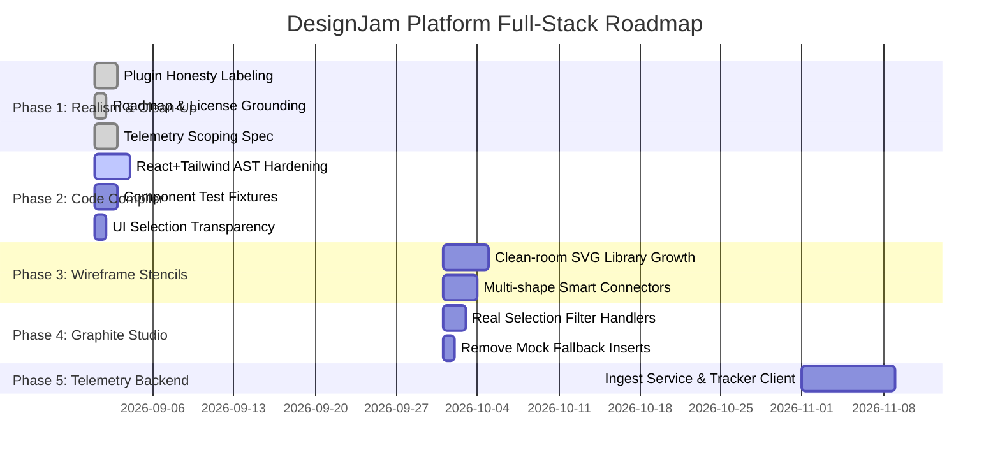

# 🌐 DesignJam Platform Architecture & Engineering Roadmap
## Unified Design-to-Code Platform Built Natively on Penpot

> **Document Purpose:** This is the authoritative technical blueprint and engineering roadmap for **DesignJam**. It specifies the platform architecture, subsystem integration, licensing compliance, and production milestones for delivering a unified, extensible design environment combining the strengths of Penpot, Graphite, Grida, Quant-UX, and Wireframe tooling into a single branded product.

---

## 1. Executive Summary & Vision

DesignJam delivers an open-source, air-gappable design-to-code operating system that bridges UI/UX design, procedural graphics, usability research, and frontend code compilation.

Rather than fragmenting the ecosystem or creating an unmaintainable Frankenstein hard-fork of upstream repositories, DesignJam adopts a **Platform-and-Plugin Architecture**:
* **Host Engine:** Unmodified Penpot (MPL-2.0) core for multi-user collaboration, SVG-native canvas, flexbox/grid layout, and enterprise workspaces.
* **Extension Layer:** Clean-room native plugins under `plugins/apps/` providing specialized superpowers.
* **Automation & Intelligence:** MCP (Model Context Protocol) server providing AI agent tool access to the design canvas.

```
┌─────────────────────────────────────────────────────────────────────────┐
│                          DesignJam Studio UI                            │
├──────────────────┬──────────────────┬─────────────────┬─────────────────┤
│ Grida Compiler   │ Open-Pencil      │ Graphite Studio │ Quant-UX Lab    │
│ (React/Tailwind) │ (Wireframes)     │ (Procedural)    │ (Analytics)     │
├──────────────────┴──────────────────┴─────────────────┴─────────────────┤
│                      Penpot Plugin Runtime (PostMessage)                │
├─────────────────────────────────────────────────────────────────────────┤
│                      Penpot Host Canvas & Document Tree                 │
│               (SVG DOM, Flex/Grid Layout, CRDT Multiplayer)             │
├─────────────────────────────────────────────────────────────────────────┤
│            Penpot Backend & Storage (PostgreSQL, Redis, S3)             │
└─────────────────────────────────────────────────────────────────────────┘
```

---

## 2. Tool Origins & Capability Mapping

| Target Capability | Original Reference Source | DesignJam Native Implementation | Current Status |
| :--- | :--- | :--- | :--- |
| **Collaborative Canvas** | [Penpot](https://penpot.app) (MPL-2.0) | Upstream Penpot host core | Production |
| **Code Generation** | [Grida](https://grida.co) (MIT/Apache) | `grida-code-compiler-plugin` (React TSX + Tailwind) | Active Hardening |
| **Low-Fi Wireframing** | [Pencil](https://openpencil.dev) (GPLv2) | `pencil-wireframe-plugin` (Clean-room SVG stencils) | Expanding |
| **Procedural Vector Math** | [Graphite](https://graphite.art) (Apache-2.0) | `graphite-studio-plugin` + `render-wasm` bezier math | Integrated |
| **Usability Telemetry** | [Quant-UX](https://quant-ux.com) (GPL/Commercial) | `quantux-analytics-plugin` + Ingest Architecture | Preview / Scoped |

---

## 3. Strict Licensing & Compliance Boundaries

Maintaining strict licensing compliance is critical for enterprise adoption and proprietary extensions:

1. **Penpot Host (MPL-2.0):**
   * All modifications to Penpot-derived files must retain original Mozilla Public License 2.0 notices.
   * Plugins communicating via the public Penpot Plugin API are separate works and do not trigger copyleft requirements.
2. **Clean-Room Stencils (Zero GPLv2):**
   * **STRICT PROHIBITION:** No source code, shape definitions, or XML from Evolus Pencil may be used. Evolus Pencil is licensed under GPLv2; importing its code would trigger virality risks.
   * All wireframe stencils in `pencil-wireframe-plugin` are authored from scratch as clean-room parametric SVGs.
3. **Graphite & Grida Alignment:**
   * Procedural curve generation and AST compilation are developed clean-room or adapted strictly from Apache-2.0 / MIT permissively licensed algorithms with attribution recorded in `THIRD-PARTY-LICENSES.md`.

---

## 4. Subsystem Architectural Specifications

### 4.1. Grida Code Compiler (`grida-code-compiler-plugin`)
* **AST Serialization:** Traverses Penpot's selected layer hierarchy, extracting geometry, flex directions, padding, gaps, fills, borders, corner radii, and text styles.
* **Target Output:** Valid, production-ready React components using TypeScript (`.tsx`) with semantic Tailwind CSS classes.
* **Future Targets:** Flutter (Dart) and Svelte 5 compilation will follow once the React+Tailwind output achieves 100% test coverage against representative design fixtures.

### 4.2. Open-Pencil Wireframe Plugin (`pencil-wireframe-plugin`)
* **Parametric Stencil Library:** Provides rough, low-fidelity UI elements (buttons, inputs, dialogs, checkboxes, mobile viewports) designed to keep early ideation focused on layout rather than high-fidelity polish.
* **Smart Connectors:** Generates orthogonal and curved connectors with arrow terminals, dynamically anchoring between shapes.

### 4.3. Graphite Studio (`graphite-studio-plugin`)
* **Procedural Vector Generators:** Generates mathematical geometry (logarithmic spirals, radial arrays, harmonic sine waves, starbursts) as clean vector paths directly on the Penpot canvas.
* **SVG Filters:** Applies non-destructive filters (Gaussian blur, drop shadows, color inversion) directly to the active canvas selection.
* **Render-WASM:** Rust WebAssembly curve routines (`bezier-rs`) integrated for sub-millisecond evaluation of complex bezier curves.

### 4.4. Quant-UX Usability Lab (`quantux-analytics-plugin`)
* **Preview Mode:** Clearly marked demo visualization for testing in-canvas overlays and funnel definitions.
* **Telemetry Roadmap:** A dedicated client tracking script (`tracker.js`) injected into prototype views transmitting interaction batches to a high-throughput event ingest backend (Postgres/ClickHouse).

---

## 5. Phase-by-Phase Execution Roadmap



### Detailed Milestones:

#### Milestone 1: Honesty, Transparency & Licensing
* Clearly label preview/synthetic data across all plugins.
* Document telemetry ingest service architecture.
* Replace fabricated tournament narratives with authoritative technical documentation.
* Establish `THIRD-PARTY-LICENSES.md` to protect intellectual property and license integrity.

#### Milestone 2: Grida Compiler Hardening
* Make React + Tailwind TSX emission rock-solid.
* Introduce automated test fixtures (Card, Navbar, Form) ensuring regression-free compilation.
* Implement clear empty/selection states in the plugin UI.

#### Milestone 3: Open-Pencil Wireframe Stencil Expansion
* Expand clean-room SVG stencils across Mobile, UI kits, and Flowcharts.
* Enable multi-shape connector creation between canvas selections.

#### Milestone 4: Graphite Selection & Filters
* Upgrade `apply-filter` to inspect and transform active selection.
* Eliminate silent dummy SVG insertions.
* Scope WebGPU node-graph pipeline cleanly for future phases.

#### Milestone 5: Usability Telemetry Ingest Service
* Implement `tracker.js` client embed.
* Stand up prototype event ingest service (`/api/telemetry/events`).
* Connect live session streams to `quantux-analytics-plugin`.

---

## 6. Performance & Quality Benchmarks

To ensure an enterprise-grade experience, all plugins and extensions must satisfy these empirical targets:

| Metric | Target | Measurement Method |
| :--- | :--- | :--- |
| **Plugin Bundle Size** | < 150 KB per plugin (gzipped) | CI esbuild output |
| **Code Generation Latency** | < 50 ms for 200+ element frame | Grida AST benchmark fixture |
| **Procedural Vector Calc** | < 16 ms (60 FPS interactive) | Graphite generator execution time |
| **Canvas Selection Response** | < 10 ms | Penpot `penpot.selection` listener |
| **Test Fixture Coverage** | 100% pass on standard fixtures | Vitest / Node test runner |
